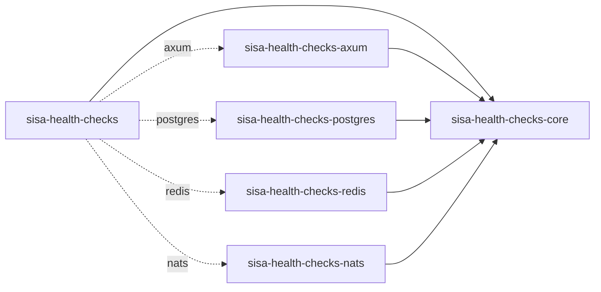
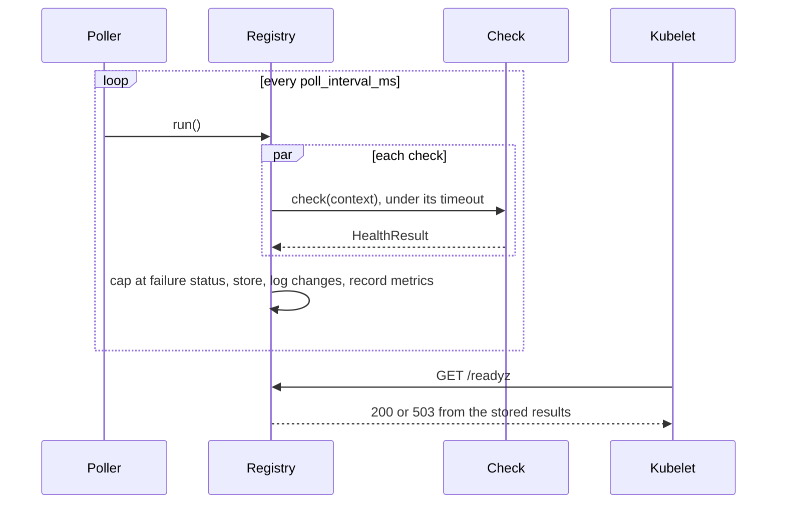

# Architecture

## The crates



| Crate | Holds | Depends on |
| --- | --- | --- |
| `sisa-health-checks-core` | The registry, the `HealthCheck` trait, results, probes, the report, `EventLoopCheck`, metrics | tokio, futures-util, serde, opentelemetry, tracing |
| `sisa-health-checks-axum` | `probe_routes` and `report_routes` | core, axum |
| `sisa-health-checks-postgres` | `PostgresCheck` | core, sqlx |
| `sisa-health-checks-redis` | `RedisCheck` | core, redis |
| `sisa-health-checks-nats` | `NatsCheck` | core, async-nats |
| `sisa-health-checks` | Re-exports, one feature per crate | all of the above |
| `sisa-health-checks-testing` | Docker servers for the integration tests; not published | testcontainers |

The core knows no web framework and no client library, so a route crate or a check crate can be
added without touching it.

## How it works



`run()` starts every check at once and waits for all of them, so a poll takes as long as its
slowest check, never more than the longest timeout. A check that times out or panics becomes an
unhealthy result with the message `timed out after <n> ms` or `the check panicked`; the others
are unaffected.

A probe reads the stored results under a read lock and builds its answer. On top of the checks
with its tag it adds:

| Line | On | Fails when |
| --- | --- | --- |
| `startup` | `/readyz`, with `wait_for_start()` | `mark_started()` hasn't been called |
| `shutdown` | `/readyz` | `begin_draining()` was called |
| `poller` | both | the last poll ended more than 3 × `poll_interval_ms` + the longest timeout ago |

A check that hasn't run yet is `pending`: it passes `/livez` and fails `/readyz`, so a starting
pod is neither restarted nor sent traffic.

### Custom checks

A check is a type that implements `HealthCheck` with an `async fn check(&self, context)`, or a
closure through `check_fn`. A crate that owns several resources can implement
`ProvidesHealthChecks` and hand the application its checks, already named and tagged, to add
with `extend`. The `CheckContext` gives the check's name and timeout, for a check that wants to
pass a shorter deadline to its client.

## Rules that hold the design together

1. **Probes never run checks.** Only `run()` calls a check. A probe or the report reads stored
   results, so a burst of probe requests costs nothing downstream and can't pile up behind a slow
   dependency.
2. **One poller per registry.** `spawn()` is called once; two pollers would double the load on
   every dependency for no gain.
3. **Every check is bounded by the registry.** The registry applies the timeout and catches the
   panic. A check never retries, sleeps between attempts or spawns a task.
4. **Liveness checks only the process.** A `live` check that touched a database would restart
   every pod at once during a database outage, which makes the outage worse.
5. **Responses carry descriptions, never errors.** The error from `with_error` goes to the logs.
   Descriptions and details reach `/health`, so they hold no credential, connection string or
   query.
6. **Status orders from best to worst.** `max` is the worst status; the failure cap is
   `status.min(failure)`. Comparing them the wrong way round turns outages into passes.
7. **Stale results fail.** A poller that died must not leave the last good answer in place, so
   both probes fail once results are older than the stale limit.

## Decisions

| Decision | Why |
| --- | --- |
| `/livez` and `/readyz`, no `/healthz` | Kubernetes deprecated `/healthz` in v1.16 for these two; one name per meaning keeps probes unambiguous. |
| No `/startupz` | The startup probe asks the same question as liveness, only with more patience; point it at `/livez`. |
| 200 to pass, 503 to fail | The kubelet passes 200–399; 503 is what load balancers and the API server use for not ready. |
| Plain text in the API server's format, `?verbose` for every line | Matches what operators already read from `kubectl get --raw /readyz?verbose`. |
| The report in `application/health+json` | The closest thing to a standard for a health document. It is an expired IETF draft (draft-inadarei-api-health-check), not an RFC, and is followed as such. |
| Results from a background poller, not per request | Probe traffic and dependency load are independent; a probe answers in microseconds. |
| Degraded passes the probes | A degraded dependency is worth seeing, not worth losing traffic over. |
| A check is a trait with `async fn`, erased internally | Users write plain async code; the boxing stays inside the registry. |
| The report on its own router | It shows details meant for an admin port, which the application chooses. |

## Formats

### Probe text

`Content-Type: text/plain; charset=utf-8`, `Cache-Control: no-store`. A passing probe without
`?verbose` answers `ok`. Otherwise every line of the probe with `?verbose`, or only the failing
lines without it, then the verdict:

```text
[+]<name> ok
[+]<name> degraded: <description>
[-]<name> failed: <description>
[-]<name> pending
readyz check failed
```

The last line is `<livez|readyz> check passed` or `<livez|readyz> check failed`.

### Report

`GET /health`, `Content-Type: application/health+json`, 503 when a check is unhealthy and 200
otherwise:

```json
{
  "status": "warn",
  "checks": {
    "postgres": [
      {
        "status": "pass",
        "observedValue": 1.8,
        "observedUnit": "ms",
        "tags": ["ready"],
        "details": { "pool_size": 4, "pool_idle": 3 }
      }
    ],
    "redis": [
      {
        "status": "warn",
        "observedValue": 2000.0,
        "observedUnit": "ms",
        "output": "timed out after 2000 ms",
        "tags": ["ready"]
      }
    ]
  }
}
```

`status` is `pass`, `warn` or `fail` for healthy, degraded and unhealthy. A check that hasn't run
is `fail` with `output` `not checked yet`. While draining, the report adds
`"notes": ["draining: /readyz fails"]`.

### Metrics

See [Observability](02-observability.md#metrics).

## Guarantees and limits

- A probe never waits on a dependency and never makes a network call.
- A poll ends within the longest check timeout, whatever the checks do.
- A dead or stuck poller fails both probes within 3 polls plus the longest timeout.
- The poller never starts a poll before the previous one ends, so it never runs a check twice at once.
- Results are as old as one poll interval: an outage shows up to `poll_interval_ms` late. Lower
  the interval, not the probe period, to see it sooner.
- The registry doesn't debounce: one failed run fails the probe. Use the probe's
  `failureThreshold` in Kubernetes to wait for several.
