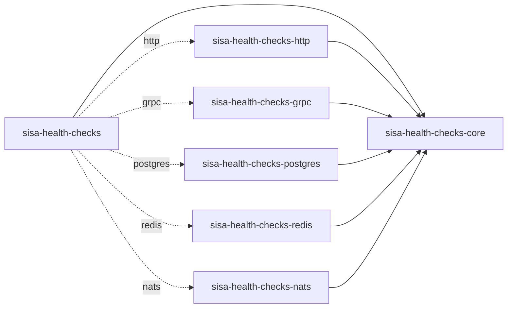

# Architecture

How the crates fit together, as 0.0.1 ships them: the crate map, what the library promises, and
the rules that hold the design together. What each crate does is in its
[spec](specs/README.md); the probe text, the report and the gRPC answers are in
[Formats](formats.md); [Flows](flows.md) draws a poll and a probe; and the
[decisions](adr/README.md) say why it is this way. The words used everywhere are in the
[docs index](README.md#words-used-everywhere).

## Crates

| Crate and its spec | Published | Holds | Depends on |
| --- | --- | --- | --- |
| [`sisa-health-checks-core`](specs/core.md) | yes | The registry, the `HealthCheck` trait, results, probes, the report, `EventLoopCheck`, metrics | tokio, futures-util, serde, opentelemetry, tracing |
| [`sisa-health-checks-http`](specs/http.md) | yes | `probe` and `report`: the `/livez`, `/readyz` and `/health` answers as plain data | core |
| [`sisa-health-checks-grpc`](specs/grpc.md) | yes | `grpc_routes`, the `grpc.health.v1.Health` service | core, connectrpc, connectrpc-health |
| [`sisa-health-checks-postgres`](specs/postgres.md) | yes | `PostgresCheck` | core, sqlx |
| [`sisa-health-checks-redis`](specs/redis.md) | yes | `RedisCheck` | core, redis |
| [`sisa-health-checks-nats`](specs/nats.md) | yes | `NatsCheck` | core, async-nats |
| [`sisa-health-checks`](specs/facade.md) | yes | Re-exports, one feature per crate | all of the above |
| [`sisa-health-checks-testing`](specs/testing.md) | no | Docker servers for the integration tests | testcontainers |

The core knows no web framework and no client library, so a protocol crate or a check crate can
be added without touching it. The http crate knows no web framework either: it gives each answer
as plain data, a status code, two headers and a body, which an application on any framework copies
into its own response.

## Guarantees and limits

- A probe never waits on a dependency and never makes a network call.
- A poll ends within the longest check timeout, as long as every check awaits. A timeout can't
  interrupt code that blocks its thread, and the checks of a poll share one task, so a check that
  blocks holds up all of them until the results go stale and both probes fail.
- A dead or stuck poller fails both probes and the report within 3 polls plus the longest
  timeout.
- The poller never starts a poll before the previous one ends, so it never runs a check twice at once.
- Results are as old as one poll interval: an outage shows up to `poll_interval_ms` late. Lower
  the interval, not the probe period, to see it sooner.
- The registry doesn't debounce: one failed run fails the probe. Use the probe's
  `failureThreshold` in Kubernetes to wait for several.

## Rules that hold the design together

1. **Probes never run checks.** Only `run()` calls a check. A probe or the report reads stored
   results, so a burst of probe requests costs nothing downstream and can't pile up behind a slow
   dependency.
2. **One poller per registry.** `spawn()` is called once; two pollers would double the load on
   every dependency for no gain.
3. **Every check is bounded by the registry.** The registry applies the timeout and catches the
   panic. A check never retries, sleeps between attempts or spawns a task.
4. **Liveness checks only the process.** A `live` check that touched a database would restart
   every pod at once during a database outage, which makes the outage worse.
5. **Responses carry descriptions, never errors.** The error from `with_error` goes to the logs.
   Descriptions and details reach `/health`, so they hold no credential, connection string or
   query.
6. **Status orders from best to worst.** `max` is the worst status; the failure cap is
   `status.min(failure)`. Comparing them the wrong way round turns outages into passes.
7. **Stale results fail.** A poller that died must not leave the last good answer in place, so
   both probes and the report fail once results are older than the stale limit.

## Decisions

Settled; reopen only with new evidence. Each one is an [ADR](adr/README.md), with its context and
the alternatives it was chosen over.
