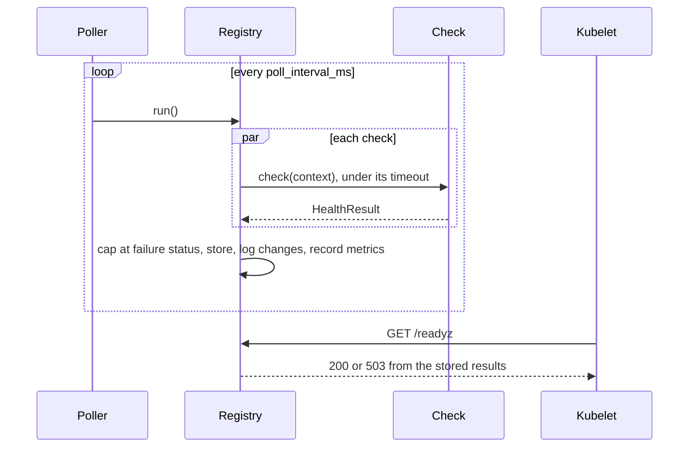

# Flows

Diagrams of each step that the [core spec](specs/core.md#behaviour) describes, across the crates.
A new flow follows [templates/flow-spec.md](templates/flow-spec.md).

## A poll and a probe

`run()` starts every check at once and waits for all of them, so a poll takes as long as its
slowest check, never more than the longest timeout. A check that times out or panics becomes an
unhealthy result with the message `timed out after <n> ms` or `the check panicked`; the others
are unaffected.

A probe reads the stored results under a read lock and builds its answer, with the lines the
[core spec](specs/core.md#behaviour) lists on top of the checks with its tag.
